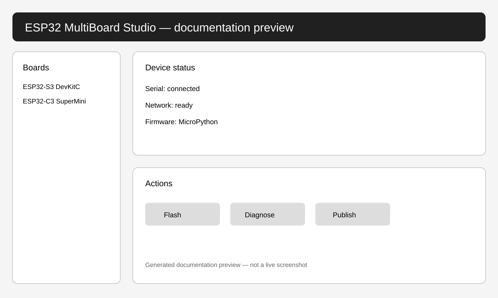

# ESP32 MultiBoard Studio 2.5.0

Cross-platform Windows/Linux React + FastAPI + MicroPython Studio for ESP32-C3/S3.

- [Русская документация](README_RU.md)
- [English documentation](README_EN.md)
- [Patch guide RU](docs/PATCHING_RU.md)
- [Patch guide EN](docs/PATCHING_EN.md)

2.5.0 preserves the working 2.3.2 network stack, adds Linux setup/start/repair/diagnostics, Linux Secret Service token storage, safer port-conflict handling, binary/full-project Git publication, and bilingual code-comment conventions.

## Contact / Контакты

- Email: [feudor.lab@yandex.ru](mailto:feudor.lab@yandex.ru)
- Telegram: [@Feudorlab1](https://t.me/Feudorlab1)

## Languages / Языки

[English](README_EN.md) · [Русский](README_RU.md) · [हिन्दी](README_HI.md) · [简体中文](README_ZH-CN.md) · [Қазақша](README_KK.md) · [Монгол](README_MN.md) · [Саха тыла](README_SAH.md) · [Беларуская](README_BE.md) · [한국어](README_KO.md)

## Screenshots / Скриншоты

> Generated documentation preview, not a live screenshot. / Сгенерированное превью документации, не снимок работающей сессии.
