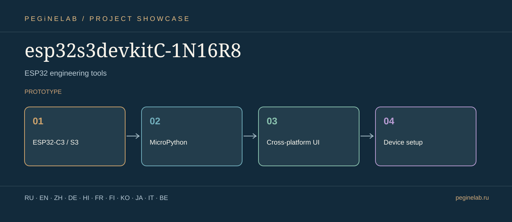

# esp32s3devkitC-1N16R8 · Visual project presentation

**Программирование ESP32 / ESP32 engineering tools** · ESP32-C3 / S3 → MicroPython → Cross-platform UI → Device setup · **prototype**.

**Translation scope:** the eleven languages below apply to this project overview; they do not claim that the running program or all documentation has eleven languages.

### Русский · ru
Кроссплатформенная студия ESP32-C3/S3 и MicroPython.. **esp32s3devkitC-1N16R8**: ESP32-C3 / S3 → MicroPython → Cross-platform UI → Device setup.

### English · en
Cross-platform ESP32-C3/S3 and MicroPython development studio.. **esp32s3devkitC-1N16R8**: ESP32-C3 / S3 → MicroPython → Cross-platform UI → Device setup.

### 简体中文 · zh
跨平台 ESP32-C3/S3 与 MicroPython 开发工作室。. **esp32s3devkitC-1N16R8**: ESP32-C3 / S3 → MicroPython → Cross-platform UI → Device setup.

### Deutsch · de
Plattformübergreifende Entwicklungsumgebung für ESP32-C3/S3 und MicroPython.. **esp32s3devkitC-1N16R8**: ESP32-C3 / S3 → MicroPython → Cross-platform UI → Device setup.

### हिन्दी · hi
ESP32-C3/S3 और MicroPython के लिए क्रॉस-प्लेटफ़ॉर्म स्टूडियो।. **esp32s3devkitC-1N16R8**: ESP32-C3 / S3 → MicroPython → Cross-platform UI → Device setup.

### Français · fr
Studio multiplateforme ESP32-C3/S3 et MicroPython.. **esp32s3devkitC-1N16R8**: ESP32-C3 / S3 → MicroPython → Cross-platform UI → Device setup.

### Suomi · fi
Monialustainen ESP32-C3/S3- ja MicroPython-kehitysympäristö.. **esp32s3devkitC-1N16R8**: ESP32-C3 / S3 → MicroPython → Cross-platform UI → Device setup.

### 한국어 · ko
ESP32-C3/S3 및 MicroPython용 크로스플랫폼 개발 스튜디오.. **esp32s3devkitC-1N16R8**: ESP32-C3 / S3 → MicroPython → Cross-platform UI → Device setup.

### 日本語 · ja
ESP32 開発ツール. **esp32s3devkitC-1N16R8**: ESP32-C3 / S3 → MicroPython → Cross-platform UI → Device setup.

### Italiano · it
Strumenti di sviluppo ESP32. **esp32s3devkitC-1N16R8**: ESP32-C3 / S3 → MicroPython → Cross-platform UI → Device setup.

### Беларуская · be
Інструменты распрацоўкі ESP32. **esp32s3devkitC-1N16R8**: ESP32-C3 / S3 → MicroPython → Cross-platform UI → Device setup.

## Contacts · Контакты

- Telegram: [@Feudorlab1](https://t.me/Feudorlab1)
- E-mails: [feudor.lab@yandex.ru](mailto:feudor.lab@yandex.ru) · [obzorniky@gmail.com](mailto:obzorniky@gmail.com)
- [peginelab.ru](https://peginelab.ru/) · [GitHub project](https://github.com/musikfed/esp32s3devkitC-1N16R8)

*Actual operating status, test results and limitations must be checked in the source repository README.*
